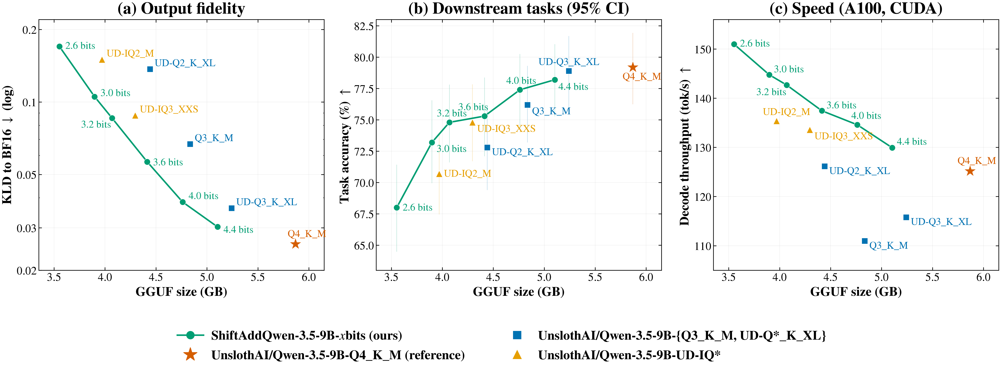

# ShiftAddQwen

**Models:** [huggingface.co/hryou1998/ShiftAddQwen-3.5-9B-GGUF](https://huggingface.co/hryou1998/ShiftAddQwen-3.5-9B-GGUF) · **Code:** this repository

**ShiftAddQwen** applies the [ShiftAddLLM](https://arxiv.org/abs/2406.05981) reparameterization to
Qwen3.5-9B (hybrid Gated-DeltaNet / full attention, with MTP head) and deploys it through llama.cpp.
Every decoder weight group is a sum of binary planes with per-group scales,
`w ≈ Σ_p α_p · b_p`, `b_p ∈ {−1, +1}`, so a mat-vec reduces to sign-select-and-add per plane plus one
scale per group. We contribute (i) an output-aware fit of this form for a hybrid-attention model,
(ii) KLD-measured mixed precision and end-to-end scale distillation, and (iii) new `ggml` quant types
with CUDA kernels, so the models run unmodified in llama.cpp (patched).

**Naming.** Our models are **ShiftAddQwen-3.5-9B-*x*bits**, *x* being the average bits per decoder
weight. Baselines are **UnslothAI/Qwen-3.5-9B-*recipe***: the public GGUF files of the same checkpoint
from [`unsloth/Qwen3.5-9B-MTP-GGUF`](https://huggingface.co/unsloth/Qwen3.5-9B-MTP-GGUF), i.e. the
standard llama.cpp recipes (`Q8_0`, `Q4_K_M`, `Q3_K_M`) and Unsloth's imatrix-calibrated dynamic
recipes (`UD-Q3_K_XL`, `UD-IQ3_XXS`, `UD-Q2_K_XL`, `UD-IQ2_M`). `Q4_K_M` (5.87 GB) is the reference
4-bit deployment.

## Results



*Figure 1. ShiftAddQwen-3.5-9B-*x*bits (*x* = average bits per decoder weight) against the
UnslothAI/Qwen-3.5-9B-* GGUF quants. (a) KL divergence to the BF16 model on held-out mixed-domain text; (b) mean accuracy on
GSM8K, MMLU-Pro, HumanEval and MGSM, with bootstrap 95% confidence intervals over the 844 items; (c) decode throughput (A100, CUDA). Vector: [docs/frontier.pdf](docs/frontier.pdf).*

Full measurements for every model in Figure 1 (KLD, PPL, per-task accuracy, prefill/decode/MTP
throughput) are in [docs/results.md](docs/results.md); raw numbers in `results/summary.json`.

**Findings.**
1. *Memory.* ShiftAddQwen-3.5-9B-4.0bits is 19% smaller than UnslothAI/Qwen-3.5-9B-Q4_K_M (4.76 vs
   5.87 GB) at near-equal quality (KLD 0.038 vs 0.026; tasks within noise), and the 4.4-bit model is
   13% smaller at KLD 0.030 with tasks within noise of Q4_K_M. ShiftAddQwen-3.5-9B-3.6bits is 25% smaller than Q4_K_M and matches UnslothAI/Qwen-3.5-9B-Q3_K_M
   in task accuracy at lower KLD (0.056 vs 0.067).
2. *Fidelity frontier.* At every size from 3.9 to 5.1 GB, ShiftAddQwen has lower KLD than the UnslothAI
   quant of equal or larger size (e.g. 0.086 at 4.07 GB vs UD-IQ3_XXS 0.088 at 4.30 GB; 0.030 at
   5.10 GB vs UD-Q3_K_XL 0.036 at 5.24 GB).
3. *Speed.* The kernels decode 4–20% faster than Q4_K_M and prefill ~27% faster, and MTP speculative
   decoding keeps its acceptance rate (0.60–0.68).

**Protocol** (details in [docs/results.md](docs/results.md)). KLD/PPL: `llama-perplexity` against the
BF16 GGUF, 512-token windows × 40, on wikitext-2 and on held-out mixed-domain text. Tasks: GSM8K,
MMLU-Pro, HumanEval, MGSM (844 items), greedy, thinking off; one run per model, so differences below
~1.5 points are noise. Speed: A100-PCIE-40GB, CUDA, `llama-bench` and `llama-server` (65K context,
with and without MTP drafting).

## Method

**Format.** `ggml` types `sa{2,3,4,5,6}[_128|_256]` (2.1–6.8 bits/weight): a super-block of 256 weights
along the input dimension stores `Q` sign planes (`Q·32` bytes), one u8 scale code per plane and
group of `G ∈ {64, 128, 256}` weights, and one fp16 scale `d`; `α = d·a`. The CUDA mat-vec turns
each nibble of sign bits into a byte mask and accumulates with `dp4a` against q8 activations, applying
the scale once per group and plane; prefill dequantizes to fp16 and uses cuBLAS. A generalized
block-wise family `sab<Q>_<bc>x<br>` (scales shared by `bc` input columns × `br` output rows, covering
ShiftAddLLM's column-wise and block-wise designs) is provided as well.

**Output-aware fit** (`saq/gptq_bcq.py`, `saq/colwise.py`). A GPTQ column sweep with act-order over
groups; at each group boundary the BCQ scales are fitted on the error-compensated weights (greedy
initialisation, alternating least squares with exhaustive code choice), and after the sweep all scales
are re-solved exactly for the Hessian-weighted output error with the codes frozen. Layers are
quantized sequentially on the outputs of the already-quantized prefix.

**Mixed precision** (`saq/sens_kld.py`, `saq/sensitivity.py`). The end-to-end KLD increase of
quantizing each linear alone at every (bits, group) setting is measured, the bf16 forward-noise floor
(≈3·10⁻⁴) subtracted, and a Lagrangian knapsack selects the setting per linear for a target average
bits/weight.

**Scale distillation** (`saq/finetune.py`, `saq/qlinear.py`). With the binary codes frozen, every scale
is trained as `α₀(1+θ)` to match the BF16 teacher's top-64 log-probabilities plus a rest-of-vocabulary
bucket, on 768 × 2048 tokens, then snapped to the u8 grid.

**Calibration.** Web/wiki 25%, English chat 20%, code 15%, multilingual chat (Aya, 20 languages) 25%,
math (MetaMathQA) 15%, so that the Hessians and the distillation targets cover the domains the model
serves.

**High precision kept** for the DeltaNet gates, conv1d and norms; the embedding (Q3_K) and LM head
(Q5_K) use llama.cpp k-quants with the Unsloth imatrix; the MTP block uses the Q4_K_M recipe.

## Run a released model

The models use new `ggml` quant types, so they need the patched llama.cpp from this repository
(stock llama.cpp refuses to load them). 6–8 GB of GPU memory is enough for a 32K context.

```bash
scripts/setup_llama.sh                   # llama.cpp b11538 + patch, CUDA build (CUDA_ARCH=80 default; set yours)
hf download hryou1998/ShiftAddQwen-3.5-9B-GGUF ShiftAddQwen-3.5-9B-4.0bits.gguf --local-dir models
work/llama.cpp/build/bin/llama-server -m models/ShiftAddQwen-3.5-9B-4.0bits.gguf -ngl 99 -fa on -c 32768 \
    --jinja --spec-type draft-mtp --spec-draft-n-max 3      # MTP speculative decoding, as in Table 1
```

## Reproduce

Running or evaluating the released GGUF models needs 6–8 GB of GPU memory (any CUDA GPU; see
[Run a released model](#run-a-released-model)). Reproducing the quantization pipeline as released
needs one CUDA GPU with ≥40 GB (the bf16 model stays resident during quantization, sensitivity
measurement and distillation), ~80 GB of disk, Python 3.12, CUDA toolkit and CMake.

```bash
pip install -r requirements.txt          # pinned versions; see the file for the torch/CUDA wheel
source scripts/env.sh                    # paths default to ./work; override SAQ_WORK, SAQ_MODEL, ...
scripts/download.sh                      # Qwen/Qwen3.5-9B + unsloth/Qwen3.5-9B-MTP-GGUF baselines
scripts/setup_llama.sh                   # llama.cpp b11538 + llama.cpp/shiftadd-b11538.patch, CUDA build, kernel tests
python tools/make_eval_text.py           # wiki.test.raw, mix.test.raw
scripts/pipeline.sh 4.0                  # sensitivity -> plan -> quantize -> distill -> GGUF -> KLD / tasks / speed
scripts/eval_baselines.sh                # same measurements for the Unsloth quants
python tools/collect.py && python tools/plot.py
```

`FT_NSEQ=64 scripts/pipeline.sh 4.0` runs a short end-to-end check. The sensitivity step runs once and
is shared by all target sizes; its four shards (`--layers 0-7`, …) can run on separate GPUs.
`slurm/example.sbatch` wraps any step for a cluster.

## Layout

| path | contents |
|---|---|
| `saq/bcq.py`, `saq/gptq_bcq.py` | BCQ primitives; output-aware fit of one linear (row-wise scales) |
| `saq/colwise.py` | block-wise / column-wise scales: fit, exact refit, packing |
| `saq/quantize_model.py` | sequential quantization of all decoder linears |
| `saq/sens_kld.py`, `saq/sensitivity.py` | KLD sensitivity, knapsack planner |
| `saq/qlinear.py`, `saq/finetune.py` | trainable ShiftAdd linears, scale distillation |
| `saq/export_gguf.py` | GGUF writer for the new types (bit-exact packing and layout checks) |
| `saq/data.py`, `saq/model.py` | calibration mixes, Qwen3.5 helpers, PyTorch KLD |
| `llama.cpp/shiftadd-b11538.patch` | ggml types: CPU reference, CUDA dequant / get_rows / mat-vec, gguf-py, tests |
| `scripts/`, `tools/` | setup, pipeline, evaluation, benchmarks, plots |

## Citation

```bibtex
@inproceedings{you2024shiftaddllm,
  title={ShiftAddLLM: Accelerating Pretrained LLMs via Post-Training Multiplication-Less Reparameterization},
  author={You, Haoran and Guo, Yipin and Fu, Yichao and Zhou, Wei and Shi, Huihong and Zhang, Xiaofan and Kundu, Souvik and Yazdanbakhsh, Amir and Lin, Yingyan Celine},
  booktitle={Advances in Neural Information Processing Systems (NeurIPS)},
  year={2024}
}
```
